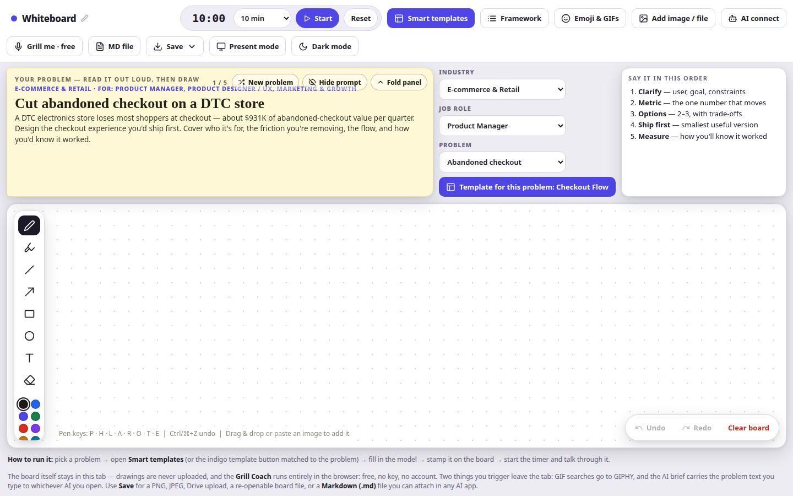
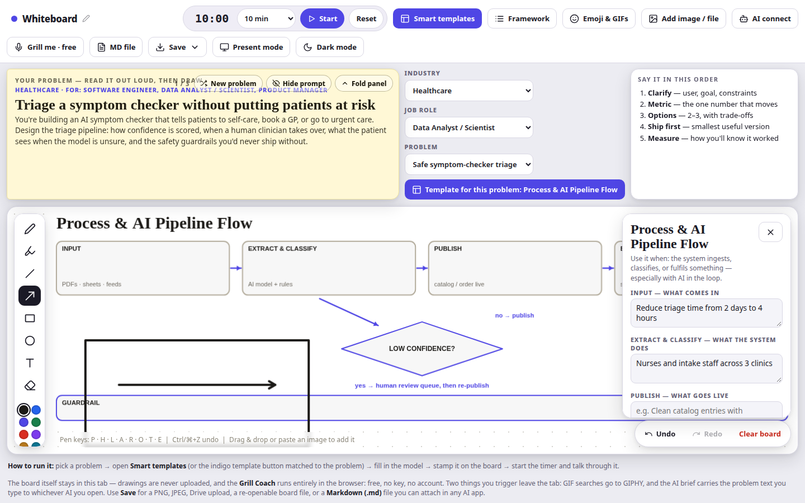
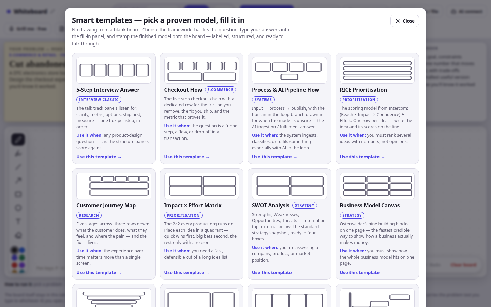
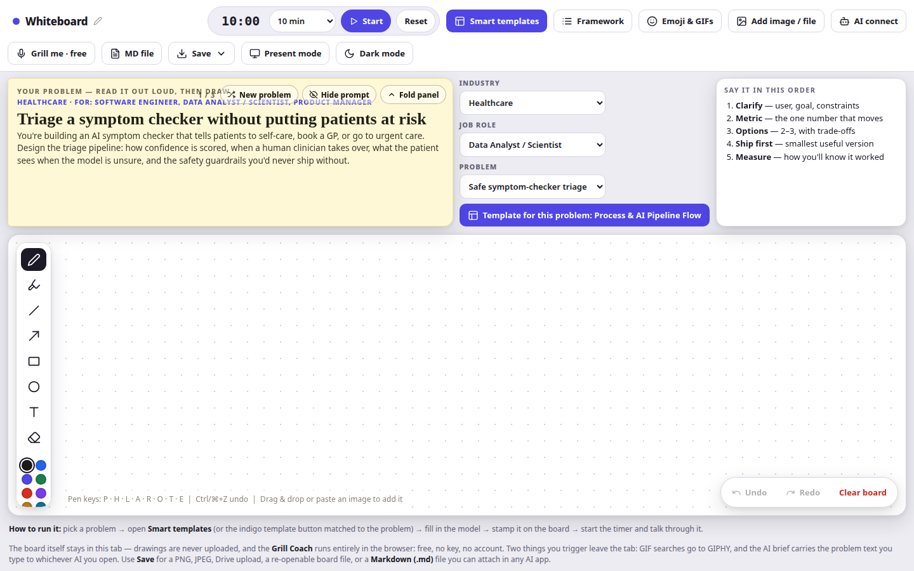
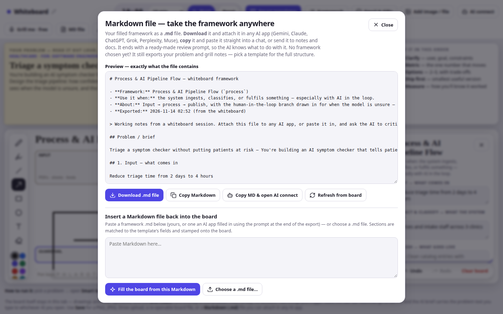
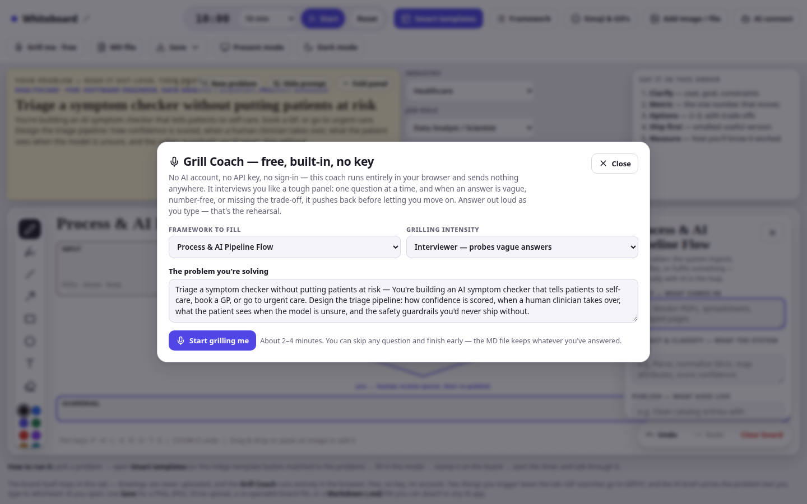

# Whiteboard — Whiteboard & Framework Studio

A free, no-signup, no-key browser whiteboard for practising product, design, engineering, data, marketing and operations interviews — and for thinking through any real problem with a proven framework.

**Just open `index.html` in a browser. No build step, no server, no account, no API key.** Everything runs locally in the tab.

## What it does

- **Draw freely** — pen, highlighter, line, arrow, box, circle, text, eraser, undo/redo, any colour, plus emoji and drag-and-drop images. GIF search (GIPHY) works when the browser can reach GIPHY; in sandboxed or offline views it falls back to pasting a GIF's image URL, dragging a GIF file onto the board, or using an emoji sticker.
- **Practice problems by industry and role** — 29 interview-style problems across 7 industries (E-commerce & Retail, Fintech & Banking, Healthcare, SaaS & B2B Software, Logistics & Delivery, Media & Streaming, Education) and 6 job roles (Product Manager, Product Designer / UX, Software Engineer, Data Analyst / Scientist, Marketing & Growth, Operations / Program). Pick an industry and a role and the problem list rebuilds to match.
- **21 smart templates** — proven frameworks (see [Frameworks](#frameworks) below). Fill in the answers and stamp the finished model onto the board, labelled and ready to talk through.
- **Diagrams — flowcharts and system architecture** — 10 flowchart shapes (Start/End, Process, Decision, Input/Output, Document, Sub-process, Manual step, Database, Delay, Connector) and 16 system-architecture shapes (User, Client app, CDN, Load balancer, API Gateway, App server, Microservice, Database, Cache, Message queue, Object storage, Auth, External API, Firewall, Monitoring, Cloud), plus 5 ready-made wired diagrams (Basic flowchart with a Yes/No loop, Three-tier web architecture, Microservices, Data pipeline, Event-driven checkout). These boxes are live objects, not fixed stamps: drag them anywhere, double-click to rename, drag a corner to resize. Every shape has 6 connector ports — drag port-to-port or click two ports to connect, with directed arrows, bidirectional arrows, dashed data/async flow, dotted dependency, or plain lines. Moving a box re-routes and re-establishes all its connections automatically; click a connector to relabel it (e.g. "HTTPS · JSON"), restyle it, or delete it.
- **A matched template for every problem** — each problem suggests the framework that fits it best.
- **Fold the problem panel away** — the New problem and Hide prompt buttons sit on the problem card itself, and one toggle folds the whole panel so the board gets the space. A floating pill brings it back.
- **Make it yours** — click the **Whiteboard** name at the top to replace it with your own company name and/or logo.
- **Interview timer and talk track** — countdown (5/10/15/20 min) or stopwatch, plus a 5-step talk track: clarify, metric, options, ship first, measure.
- **Present mode** — hides the panels and timer for a clean screen-share.
- **Markdown export / import** — export the filled framework as a `.md` file, or paste one back in and the board refills the matching template. The export ends with a review prompt any AI app can follow.
- **Paste an AI plan back as JSON** — when an AI app replies with a filled framework as JSON (`{"template": "checkout", "values": {...}}`), paste it into the board and it fills the matching template's fields. Smart quotes, markdown fences and trailing commas are handled.
- **Grill Coach — free, built-in, no key** — a questioning coach that interviews you through the framework one question at a time at three intensities (Supportive, Interviewer, Tough panel), pushes back on vague, number-free or trade-off-free answers, then pressure-tests your riskiest assumption.
- **AI connect** — one click copies a ready-made brief to Gemini, Claude, Grok, Perplexity, ChatGPT or Muse, and an in-page MCP manifest (`window.WhiteboardMCP`) lets an agent working inside the tab fill frameworks for you.
- **Save your work** — PNG, JPEG, a re-openable `.json` board file, copy-to-clipboard, or a Google Drive upload.
- **Light mode by default, with a dark-mode toggle.**

## Demo — try it in 2 minutes

1. Open `index.html`.
2. Pick an **industry** (say Healthcare) and a **job role** (say Data Analyst / Scientist) — the problem becomes *“Triage a symptom checker without putting patients at risk.”*
3. Hit the indigo **Template for this problem** button — the Process & AI Pipeline Flow template stamps onto the board.
4. Fill in two fields, for example: *“Reduce triage time from 2 days to 4 hours”* and *“Nurses and intake staff across 3 clinics.”*
5. Hit **Grill me · free** and answer the coach's first question out loud.
6. Hit **MD file** to export the finished framework as Markdown — or paste an AI's JSON plan back in and watch the board fill itself.

## Frameworks

All 21, grouped by what they are for:

**Interview structure**
- 5-Step Interview Answer — clarify, metric, options, ship first, measure. One box per step.
- Checkout Flow — the five-row checkout chain: friction, fix, metric.
- Process & AI Pipeline Flow — input → process → publish, with a human-in-the-loop branch for low confidence.

**Prioritisation**
- RICE Prioritisation — (Reach × Impact × Confidence) ÷ Effort, one row per idea.
- Impact × Effort Matrix — the 2×2: quick wins first, big bets second.
- MoSCoW Prioritisation — must, should, could, won't.
- Kano Model — basic, performance and delight features.

**Research & customers**
- Customer Journey Map — five stages across, three rows down: what the customer does, feels, and where the pain lives.
- Jobs-to-be-Done — the job, the struggle, the desired outcome.
- Empathy Map — what users say, think, do and feel.
- Opportunity Solution Tree — outcome, opportunities, solutions, experiments.

**Strategy & business**
- SWOT Analysis — internal on top, external below.
- Business Model Canvas — Osterwalder's nine building blocks on one page.
- Lean Canvas — the one-page startup version: problem, solution, unfair advantage.
- Double Diamond — discover, define, develop, deliver.
- Porter's Five Forces — the five pressures on a market.
- 5 Whys — five layers down to the root cause.

**Product & growth**
- North Star Metric — the one number that moves, and its inputs.
- AARRR Funnel — acquisition, activation, retention, revenue, referral.
- HEART Framework — happiness, engagement, adoption, retention, task success.
- Wireframe Kit — Web + Mobile — boxes and flows for a quick layout sketch.

## Screenshots

### Smart templates — pick a proven model, fill it in

### Problems by industry and job role

### Markdown export — take the framework anywhere

### Grill Coach — free interview practice, no key

## How to use it

1. Open `index.html` — or try it live wherever it is hosted.
2. Pick an **industry** and a **job role**, then a problem — or hit **New problem** to shuffle.
3. Open **Smart templates** (or the indigo button matched to your problem), fill in the model, and stamp it on the board.
4. Start the timer and talk through it using the 5-step track on the right.
5. Stuck? Hit **Grill me · free** and let the coach probe your answers.
6. **MD file** exports the finished framework to share with any AI app or teammate.

Keyboard: `P` pen, `H` highlighter, `L` line, `A` arrow, `R` box, `O` circle, `T` text, `E` eraser, `Ctrl/⌘+Z` undo.

## Privacy — honest notes

- Your drawings and answers never leave the tab. Nothing is uploaded.
- The Grill Coach runs entirely in your browser. It is a built-in question bank with probing rules — not a cloud LLM. A standalone page cannot run a real model for free without someone's API key.
- Two things do leave the tab when you trigger them: GIF searches go to GIPHY, and the AI-connect brief carries the problem text you type to whichever AI you open.
- Google Drive save is a manual upload: the PNG downloads and Drive opens. The page cannot write to Drive without a Google sign-in.
- Rebranding (your company name or logo) is session-only — it resets when the tab closes.

## Tech

A single self-contained `index.html` — plain HTML, CSS and vanilla JavaScript. No dependencies, no build, no backend. Works offline except GIF search and the AI handoff, which need the network.

## Contributing

Issues and pull requests are welcome — new practice problems (any industry or role), new frameworks, and accessibility fixes are the most useful contributions. Keep problems realistic, specific, and solvable on one board in 10 minutes.

## License

MIT — see [LICENSE](LICENSE).
